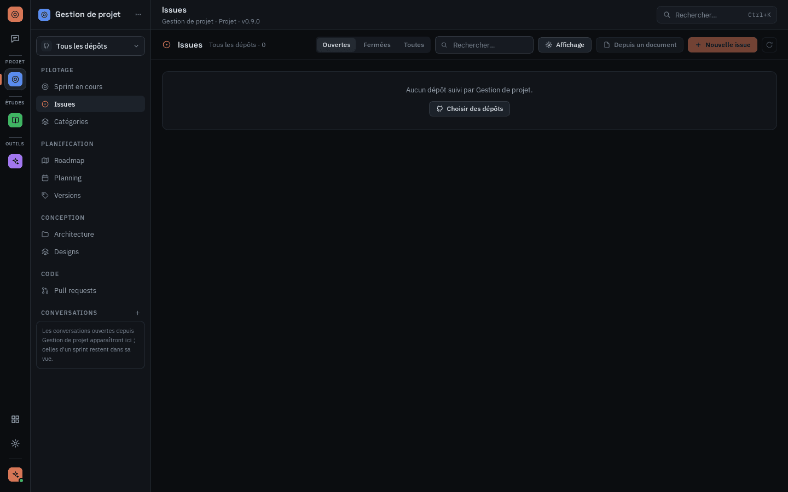
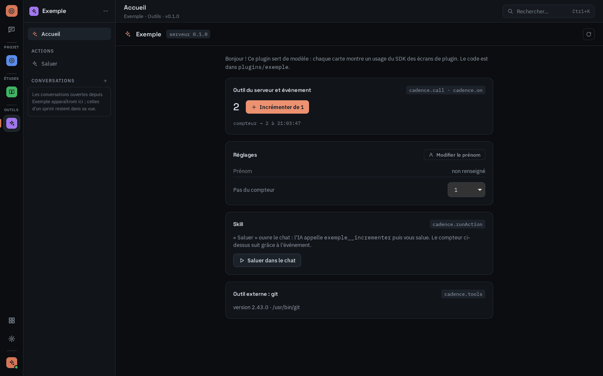

# Cadence

**Vos IA de code. Vos plugins. Une seule app.**

Cadence est une application de bureau qui pilote les IA de code déjà installées sur votre machine
(Claude Code, Codex CLI, OpenCode) et leur donne les outils des **plugins** que vous choisissez :
gestion de projet GitHub, cours et révisions, et ce que la communauté publie.

- **Vos abonnements, pas de clé** : Cadence lance l'IA déjà connectée à votre compte. Aucune clé
  d'API à saisir, aucun compte Cadence.
- **Un chat qui agit** : l'IA utilise les outils des plugins activés, et chaque plugin ajoute ses
  écrans et ses boutons d'action (« Compléter l'issue », « Générer un QCM »…).
- **Des plugins relus** : le catalogue est un dépôt public, chaque plugin y entre après relecture.
- **Vos dépôts protégés** : l'IA travaille dans un dossier neutre, jamais directement dans vos
  projets.

| Le chat | Le catalogue de plugins |
| --- | --- |
|  |  |

## Les plugins officiels

| | Plugin | Pour quoi faire |
| --- | --- | --- |
|  | **Gestion de projet** | piloter vos dépôts GitHub : issues, sprints, roadmap, versions, pull requests, avec l'IA pour compléter, développer et relire |
|  | **Documents** | ranger vos cours (PDF, Word, PowerPoint, Markdown), prendre des notes, réviser avec des QCM, des questions ouvertes et des flashcards |
|  | **Exemple** | le modèle pour écrire votre propre plugin |

Ils se trouvent dans [`RemiSDV/cadence-plugins`](https://github.com/RemiSDV/cadence-plugins) et
s'installent depuis l'app.

## Télécharger

Dernière version sur la page des [releases](https://github.com/RemiSDV/cadence/releases/latest) :

| Système | Fichier |
| --- | --- |
| Windows 10/11 | `Cadence_<version>_x64-setup.exe` |
| Linux (Debian, Ubuntu) | `Cadence_<version>_amd64.deb` |
| Linux (Fedora, openSUSE) | `Cadence-<version>-1.x86_64.rpm` |
| Linux (autres) | `Cadence_<version>_amd64.AppImage` |

## Documentation

- **[Guide d'utilisation](docs/utilisation.md)** : installer, premier lancement, chat, plugins,
  connexion GitHub, réglages.
- **[Documentation technique](docs/technique.md)** : construire depuis les sources, architecture,
  conventions de code.
- [Processus de release](docs/release.md), pour les mainteneurs.
