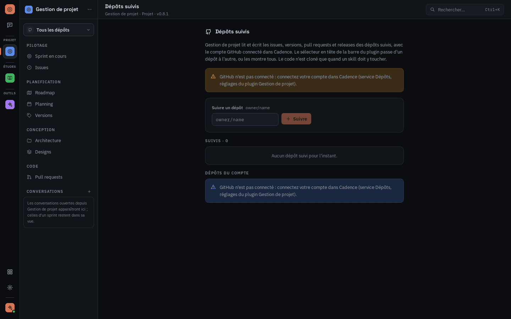

# Cadence

Application de bureau Tauri 2. **Cadence 2 (0.3.0, branche `cadence-2`)** : un hôte entre les IA
de code (Claude Code, Codex CLI, OpenCode) et des plugins installés depuis le catalogue public
`RemiSDV/cadence-plugins` ; la gestion de projet GitHub de Cadence 1 (tag `v0.2-final`) devient le
plugin `gestion-projet`, les agents deviennent des boutons liés à des skills.

- Maquettes : canvas « Cadence — Écrans de l'app » (page « Cadence 2 » : `V2-*.dc.html`)
- Plan technique : doc « Cadence 2 — Plan technique (hôte IA + plugins) », révision 1.1
- **Documentation utilisateur et mainteneur : [`docs/`](docs/README.md)** (encore celle de la 0.2)

Socle en place : coque à trois colonnes (rail 56px groupé par catégorie, barre contextuelle
220px, contenu), réglages de la machine v2 (`settings.json`, migré depuis la v1), registre des
plugins installés (activation globale, ordre du rail, réglages et secrets globaux), trousseau
générique. Les écrans GitHub de Cadence 1 restent compilés jusqu'au plugin `gestion-projet`.

## Présentation


Cadence relie les **IA de code déjà installées sur votre machine** (Claude Code, Codex CLI,
OpenCode) à des **plugins** qui apportent les fonctionnalités : gestion de projet GitHub, cours et
révisions, etc. Sans plugin, vous avez un chat ; avec eux, des écrans, des boutons d'action et des
outils que l'IA sait utiliser.

- **Vos abonnements, pas de clé** : Cadence lance la CLI déjà connectée à votre compte. Aucune clé
  d'API à saisir, aucun compte Cadence.
- **Des plugins relus** : le catalogue est le dépôt public
  [`RemiSDV/cadence-plugins`](https://github.com/RemiSDV/cadence-plugins) ; chaque plugin y entre
  par une pull request relue et chaque archive est vérifiée par son empreinte SHA-256.
- **Un dossier de travail neutre** : l'IA est toujours lancée dans un dossier de session de Cadence,
  jamais dans un de vos dépôts. Elle accède aux données par les outils des plugins.

## Télécharger

Les installeurs sont sur la page des
[releases](https://github.com/RemiSDV/cadence/releases/latest) :

| Système | Fichier | Remarque |
| --- | --- | --- |
| Windows 10/11 x64 | `Cadence_<version>_x64-setup.exe` | mises à jour automatiques |
| Linux x64 (Debian, Ubuntu) | `Cadence_<version>_amd64.deb` | `sudo apt install ./Cadence_<version>_amd64.deb` |
| Linux x64 (Fedora, openSUSE) | `Cadence-<version>-1.x86_64.rpm` | `sudo dnf install ./Cadence-<version>-1.x86_64.rpm` |
| Linux x64 (autres) | `Cadence_<version>_amd64.AppImage` | `chmod +x` puis lancer le fichier |

Les paquets Linux demandent glibc 2.39 ou plus (Ubuntu 24.04, Debian 13, Fedora 40 et suivantes)
et WebKitGTK 4.1. Ils ne sont pas signés pour l'updater : une nouvelle version s'installe à la main.
Pour construire l'app vous-même, voir [Installer Cadence depuis les sources](#installer-cadence-depuis-les-sources).

## Utiliser Cadence

### 1. Premier lancement

Au premier lancement, un parcours en cinq étapes (environ 4 minutes) prépare l'app. Tout reste
modifiable ensuite dans les réglages.

1. **IA de code** : Cadence cherche Claude Code, Codex CLI et OpenCode, vérifie qu'ils sont
   connectés à votre compte et propose d'installer ceux qui manquent (la commande exacte est
   affichée avant d'être lancée). Choisissez l'**IA par défaut** : elle répond dans le chat et
   exécute les boutons d'action. « Lancer le test » ouvre une courte session pour vérifier que tout
   répond.
2. **Plugins** : cochez les plugins du catalogue à installer. Aucun n'est obligatoire : le chat
   fonctionne sans.
3. **Outils nécessaires** : Cadence vérifie les programmes dont dépendent vos IA et vos plugins
   (Git, CLI GitHub…). « Continuer » reste grisé tant qu'un outil requis manque.
4. **Configuration** : chaque plugin affiche ses propres étapes (connexion GitHub et choix des
   dépôts suivis pour Gestion de projet, prénom pour Exemple…). « Configurer plus tard » les
   reporte.
5. **Terminé** : un récapitulatif, puis « Ouvrir Cadence ».

| IA de code | Outils nécessaires | Configuration d'un plugin |
| --- | --- | --- |
|  |  |  |

### 2. Se repérer


- **Le rail** (colonne de gauche) : le chat en haut, puis un bouton par plugin activé, rangé dans
  le groupe de sa catégorie (Projet, Études, Code, Données, Outils). En bas : le catalogue, les
  réglages et l'IA par défaut (la pastille verte indique qu'elle est connectée).
- **La barre contextuelle** (deuxième colonne) : les vues et les conversations de l'écran courant.
- **Le contenu** au centre, et pour le chat un panneau de session à droite (IA, passerelle MCP,
  outils visibles, accès aux dépôts).
- **`Ctrl+K`** ouvre la palette : aller à un écran, ouvrir un plugin, lancer une action.


### 3. Discuter avec l'IA

Le **chat** voit les outils de tous les plugins activés. Une conversation ouverte depuis un plugin
(le `+` de « Conversations » dans sa barre) lui est rattachée et apparaît aussi dans sa barre ;
celles d'un sprint restent dans la vue du sprint. Sous la zone de saisie :

- le choix de l'**IA** pour cette conversation ;
- le **mode** : *Demander* (chaque commande, modification ou outil attend votre accord),
  *Édition auto* (modifie les fichiers sans demander, demande avant une commande shell) ou *Auto*
  (tout est autorisé, à réserver aux tâches sûres) ; « Autoriser pour la session » évite de
  redemander pour une même famille de commandes ;
- **Skills** pour déclencher un skill d'un plugin, et le trombone pour joindre un fichier.

Quand l'IA attend une réponse de votre part, la conversation l'indique (« En attente de votre
réponse »). Les conversations se retrouvent dans la barre de gauche et par la recherche.

### 4. Installer et gérer des plugins


Le **catalogue** (icône en grille en bas du rail) liste les plugins publiés, filtrables par
catégorie. La fiche d'un plugin montre ses vues, ses actions (*chat* : ouvre une conversation ;
*en fond* : s'exécute sans vous) et ses outils MCP. Depuis la fiche : **Installer**, **Ouvrir**,
**Désactiver**, **Réglages**, **Désinstaller** (les données du plugin sont conservées).

En haut du catalogue :

- **Installer une archive…** : un `.zip` de plugin (lien partagé ou archive construite soi-même) ;
- **Dossier de développement…** : un dossier de plugin non zippé, pour les auteurs (il n'est jamais
  copié ni modifié par Cadence) ;
- **Actualiser** : relit le catalogue. Les mises à jour peuvent aussi s'installer seules (Réglages ›
  Général › « Mettre à jour les plugins automatiquement »).

> **Linux** : les plugins publiés au catalogue n'embarquent pour l'instant qu'un serveur Windows ;
> le catalogue les marque alors « Incompatible ». En attendant, construisez-les depuis
> `cadence-plugins` (`pnpm install && pnpm build && cargo build --release`, copiez les serveurs de
> `target/release/` dans `<dossier>/linux-x86_64/`, puis
> `pnpm package <id> --bins <dossier> --allow-missing-targets`) et installez l'archive de `out/`
> avec « Installer une archive… ».

### 5. Les plugins officiels

**Gestion de projet** pilote un ou plusieurs dépôts GitHub : sprint en cours, issues, roadmap,
planning, versions, architecture, designs et pull requests. Il a besoin du service **Dépôts
GitHub** : connectez votre compte (Réglages › Dépôts GitHub, voir [Connexion GitHub](#connexion-github)),
puis « Choisir des dépôts » pour suivre des dépôts. Le sélecteur en haut de sa barre passe d'un
dépôt à l'autre ou les montre tous. Les actions (« Compléter l'issue », « Développer le sprint »,
« Relire et valider », « Préparer la release »…) lancent l'IA sur la tâche, dans un worktree dédié.

| Issues | Dépôts suivis |
| --- | --- |
|  |  |

**Documents** range vos cours (PDF, Word, PowerPoint, Markdown) par matière et chapitre, et vos
notes en Markdown (éditeur par blocs : tapez `/` pour insérer un titre, une liste, un tableau, un
lien vers un cours). Ses actions : poser une question (réponse citée avec document et page),
générer un QCM, des questions ouvertes corrigées, des flashcards, résumer un chapitre en note.
L'onglet Entraînement garde l'historique des scores.

| Bibliothèque | Note |
| --- | --- |
|  |  |

**Exemple** est le plugin de référence pour les auteurs : un compteur qui utilise chaque brique de
l'API (outil MCP, événement, réglages, étape de configuration, skill, outil externe).


### 6. Réglages


- **Général** : mises à jour de Cadence (À propos), export de la configuration en JSON (les secrets
  restent au trousseau), URL du catalogue, mise à jour automatique des plugins, dossiers des
  plugins, de leurs données et des sessions d'IA.
- **IA de code** : détection, IA par défaut, IA utilisée par chaque action.
- **Outils externes** : état des programmes requis, installation en un clic.
- **Dépôts GitHub** : compte connecté, emplacement des clones, dépôts suivis par plugin.
- **Plugins activés** : ordre du rail, réglages et secrets de chaque plugin.

## Démarrer

Prérequis : Node 20+, pnpm, Rust stable (MSVC sous Windows), WebView2.

```bash
pnpm install
pnpm dev          # UI seule dans le navigateur, données mockées (http://localhost:1420)
pnpm tauri dev    # app de bureau, back Rust réel
pnpm tauri:mock   # app de bureau, back mocké (tant que les commandes Rust ne sont pas branchées)
```

| Commande | Rôle |
| --- | --- |
| `pnpm typecheck` | TypeScript strict |
| `pnpm test` | tests front (Vitest) |
| `pnpm test:rust` | tests Rust + régénération des types TS |
| `pnpm bindings` | régénère seulement `src/lib/bindings` depuis Rust (ts-rs) |
| `pnpm format` | Prettier + tri des classes Tailwind |
| `pnpm build` | build de prod du front |

### Installer Cadence depuis les sources

Pour une autre plateforme que celles des [releases](#télécharger), ou pour tester une branche,
chacun construit l'app sur sa machine (procédure de release : `docs/release.md`).

1. Prérequis : Node 20+ et pnpm, Rust stable (`rustup`), plus selon le système :
   - **Windows** : Visual Studio Build Tools avec « Développement Desktop en C++ » (Rust MSVC) ;
     WebView2 est déjà présent sur Windows 10 et 11 ;
   - **macOS** : outils en ligne de commande Xcode (`xcode-select --install`) ;
   - **Linux** : `libwebkit2gtk-4.1-dev`, `build-essential`, `libssl-dev`,
     `libayatana-appindicator3-dev`, `librsvg2-dev` (noms Debian/Ubuntu).
2. Construire :

   ```bash
   git clone https://github.com/RemiSDV/cadence.git && cd cadence
   pnpm install
   pnpm tauri build
   ```

3. L'installeur est dans `src-tauri/target/release/bundle/` : `nsis/*.exe` ou `msi/*.msi` sous
   Windows, `dmg/*.dmg` sous macOS, `deb/`, `rpm/` ou `appimage/` sous Linux. Non signé : Windows
   affiche « éditeur inconnu » (Informations complémentaires › Exécuter quand même), macOS demande
   un clic droit › Ouvrir la première fois.

### Connexion GitHub

**Aucune configuration n'est nécessaire** sur une machine où la CLI GitHub ou Git sont installés.
Méthodes, dans l'ordre proposé à l'écran :

| Méthode | Comment | Besoin |
| --- | --- | --- |
| Compte de la CLI GitHub | reprend la session de `gh` en un clic (`gh auth token`) | `gh` connecté |
| Navigateur | Git Credential Manager ouvre GitHub dans le navigateur et rend la main tout seul (il a sa propre application OAuth) | Git pour Windows / GCM |
| Navigateur, OAuth App de Cadence | flux web direct : redirection vers `127.0.0.1`, PKCE | client ID + client secret |
| Code d'appairage | device flow : un code à saisir sur github.com/login/device | client ID, device flow activé |
| Jeton personnel | jeton classique collé dans l'app | rien |

Dans tous les cas, le jeton est validé auprès de GitHub puis copié dans le trousseau de l'OS sous
l'entrée de Cadence ; il n'est jamais affiché ni renvoyé au webview. Seule la portée `repo` est
bloquante : l'écran signale les autres portées manquantes.

#### Optionnel : OAuth App propre à Cadence

Utile pour une distribution publique (l'écran d'autorisation GitHub affiche alors « Cadence »).
Créer l'**OAuth App** : github.com › Settings › Developer settings › OAuth Apps › New OAuth App.

1. **Authorization callback URL** : `http://127.0.0.1/callback` (GitHub accepte tout port sur cette
   adresse loopback ; Cadence en choisit un libre à chaque connexion) ;
2. cocher **Enable Device Flow** (pour le code d'appairage) ;
3. générer un client secret ;
4. exporter les deux valeurs avant `pnpm tauri dev` (lues à l'exécution, ou figées au build) :

```powershell
$env:CADENCE_GITHUB_CLIENT_ID="Ov23li..."
$env:CADENCE_GITHUB_CLIENT_SECRET="..."
```

Le client secret est compilé dans l'app : dans une app native il ne peut pas rester confidentiel
(RFC 8252, même choix que la CLI `gh`). PKCE et le paramètre `state` empêchent qu'un code
d'autorisation intercepté soit utilisable. Le jeton obtenu est rangé dans le trousseau de l'OS
(Keychain, Credential Manager, Secret Service), jamais dans le webview ni sur disque.

### Mode mock

En mode navigateur, l'URL pilote le scénario mocké :

- par défaut : cinq plugins factices dans le rail (Gestion de projet, Documents, Bibliographie,
  Explorateur SQL, Journal de bord) et un Minuteur désactivé ; `?scenario=empty` : aucun plugin ;
- `?scenario=onboarding` : onboarding à faire, compte GitHub non connecté ; `?scenario=no-project` : aucun dépôt choisi ;
- `&flow=denied|expired|config` : issue du device flow simulé (par défaut, autorisé après 6 s) ;
- `&cli=fail` : session de test de Claude Code en échec ;
- `&update=available|fail` : mise à jour de l'app simulée (Réglages › À propos) ;
- `?view=<id>` force un écran (`?view=settings&section=plugins`, `?view=catalog`,
  `?view=plugin&plugin=documents&page=flashcards`, `?view=design-system`, `?view=issue&number=156`).

La **galerie de composants** (`?view=design-system`, ou `Ctrl+K` → « Galerie de composants ») montre
toutes les briques du design system avec les données des maquettes.

## Architecture

```
cadence/
├─ src/                        # front React 19 + TypeScript
│  ├─ app/                     # racine : providers, démarrage, cadre des vues, modales globales
│  ├─ views/                   # un écran du canvas = une vue ; registry.tsx les déclare toutes
│  ├─ components/
│  │  ├─ icons/                # les 34 icônes des maquettes (Icon name="…")
│  │  ├─ ui/                   # primitives du design system (Button, Badge, Field, Dialog…)
│  │  ├─ domain/               # briques métier (PluginTile, SettingsForm, IssueCard, DiffViewer…)
│  │  └─ layout/               # AppRail, ContextBar/PluginBar/ChatBar, Page/TopBar, CommandPalette
│  ├─ stores/                  # Zustand : navigation (vue courante), état d'interface
│  ├─ lib/
│  │  ├─ bindings/             # GÉNÉRÉ par ts-rs — ne pas éditer
│  │  ├─ types.ts              # point d'import unique des types partagés
│  │  ├─ ipc/                  # contrat des commandes, transport Tauri/mock, événements
│  │  ├─ query/                # TanStack Query : client, clés, hooks, pont événements → cache
│  │  └─ domain/               # vocabulaire métier → libellés/couleurs, formats FR, semver
│  └─ styles/globals.css       # tokens du design system (Tailwind v4 @theme)
└─ src-tauri/                  # cœur Rust
   ├─ src/
   │  ├─ commands/             # surface IPC, une commande par intention métier
   │  ├─ domain/               # types du contrat (exportés en TS)
   │  ├─ api/github/           # client GitHub, régimes de quota
   │  ├─ auth/                 # device flow, trousseau, détection des CLI d'agents
   │  ├─ app_settings/         # settings.json v2 (IA, plugins de dev…) et migration v1 → v2
   │  ├─ plugins/              # plugin.toml, registre installed.json, réglages globaux
   │  ├─ secrets.rs            # trousseau générique (plugin/<id>/<secret>)
   │  ├─ ai/                   # IA de code (lecture stream-json de Claude Code)
   │  ├─ store/  sync/  vcs/   # cache SQLite, moteur de sync, git/worktrees
   │  ├─ events.rs             # événements back → front
   │  └─ error.rs              # AppError → { kind, message }
   └─ migrations/              # schéma SQLite du cache
```

Principes (du plan technique) :

- Le webview n'a ni jeton ni accès à l'API GitHub : tout passe par une commande Rust.
- Une commande par intention métier ; le front ne compose jamais plusieurs appels pour une vue.
- Les vues lisent le cache via TanStack Query et se rafraîchissent sur `sync://updated`.
- Navigation par état (`useNavigation`), sans routeur d'URL.
- Les types du contrat sont écrits une fois en Rust et générés en TS : un changement casse à la compilation.

## Recettes

**Implémenter un écran** — créer `src/views/<zone>/<Nom>View.tsx` (export par défaut, prop `view`
typée), puis remplacer son `placeholder(...)` dans `src/views/registry.tsx` par
`lazy(() => import("./<zone>/<Nom>View"))`. Composer avec `Page` (en-tête + zone principale),
`components/domain` et `components/ui` ; lire les données avec les hooks de `lib/query/queries.ts`.

**Ajouter une commande** — 1. l'écrire dans `src-tauri/src/commands/<domaine>.rs` avec ses types dans
`domain/` (`#[ts(export)]`) ; 2. l'enregistrer dans `lib.rs` ; 3. `pnpm bindings` ; 4. la déclarer dans
`src/lib/ipc/commands.ts` et lui donner un handler dans `src/lib/ipc/mock/handlers.ts` (le
typage refuse un oubli) ; 5. exposer un hook dans `lib/query/queries.ts`.

**Ajouter une couleur ou une taille** — dans `src/styles/globals.css` (`@theme`) ; une nouvelle taille de
texte ou un nouveau rayon se déclare aussi dans `src/lib/cn.ts` pour que `cn()` fusionne correctement.

## État

- **Fondations** : design system complet, architecture front/back, contrat IPC typé (32 commandes,
  toutes mockées), navigation et palette de commandes.
- **Onboarding 1 — Connexion GitHub** : branché de bout en bout (compte de la CLI GitHub, navigateur via Git Credential Manager ou OAuth App, code d'appairage, trousseau,
  jeton personnel, changement de compte).
- **Onboarding 2 — Agents de code** : détection de Claude Code et Codex CLI (réglage manuel, `PATH`,
  emplacements usuels), session de test headless de Claude Code, localisation manuelle du binaire,
  désactivation, affectation des rôles. Les préférences de la machine sont dans
  `<config de l'app>/settings.json`.
- **Sélecteur de dépôt** (haut de la barre latérale, ou `Ctrl+K` → « Changer de dépôt ») : Cadence
  fonctionne sur n'importe quel dépôt accessible au compte (une requête GraphQL, filtrée localement),
  et permet d'en créer un (compte personnel ou organisation, privé ou public, README initial).
  Ouvrir un dépôt importe ses milestones comme versions ; le choix est mémorisé et rouvert au
  lancement suivant. Sans dépôt mémorisé, le sélecteur s'ouvre de lui-même. `versions_list` est branché.
- **Issues** : toutes les issues du dépôt ouvert (pull requests exclues), groupées par version avec
  leur avancement ; filtres texte / version / état / assigné, sélection multiple. Les actions
  groupées et l'agent CTO arrivent avec l'écriture (0.1.2+).
- **Cache SQLite** (`sqlx`) : une base par dépôt, `<données locales de l'app>/cache/<owner>/<nom>.sqlite3`,
  migrée à l'ouverture (`PRAGMA user_version`). Issues et milestones y sont rangés avec leur JSON
  brut ; une passe au plus par minute, incrémentale (`since` = dernier `updated_at` vu) et
  conditionnelle (ETag : un dépôt calme répond `304` sans consommer de quota). L'app sert le cache
  hors ligne et au lancement. La déconnexion supprime toutes les bases.
- **Pull requests** : PR ouvertes et 30 dernières fusionnées ou fermées, triées par activité (une
  requête GraphQL par minute au plus : CI du dernier commit, approbations, changements demandés,
  attente de revue, issue fermée, version). Filtres version / état / auteur / origine (agent si
  label `agent/*`). Une ligne ouvre l'écran de revue.
- **Revues à faire** : PR dont vous êtes relecteur, et vos PR qui attendent une revue ; pour la PR
  choisie, diff fichier par fichier (patchs lus en REST), description, impact sur la version. Les
  boutons de revue arrivent avec l'écriture (0.1.2), le résumé de l'agent CTO en 0.1.3.
- **Roadmap** : une carte par version, livrées et en cours en haut, sprints planifiés et paliers en
  bas, avec avancement et trois issues (ouvertes d'abord). Convention : la première ligne de la
  description du milestone nomme la version (`# Cockpit Tauri`), ses éléments de liste sont les
  thèmes d'un palier ; un sprint commence à l'échéance du précédent.
- **Nouvelle issue** (bouton des écrans, `Ctrl+K`) : titre et version obligatoires (milestone ouvert),
  type posé en label `type/*`, labels libres, assignation à soi. Créée sur GitHub puis rangée dans
  le cache. L'envoi à l'agent CTO arrive en 0.1.3.
- **Clôture de version** (roadmap, `Ctrl+K`) : version suivante (sprint, palier, majeure ou saisie),
  sort des issues ouvertes (reporter, retirer, fermer comme non retenues), aperçu exact des
  écritures. Tout est vérifié avant la première écriture (version semver plus grande, tag libre,
  branche lisible), puis : milestone suivant créé ou daté (sprint de 14 jours), issues traitées,
  milestone fermé, tag léger posé sur la branche par défaut, brouillon de release avec notes
  générées (jamais publié automatiquement). Si une étape échoue, l'erreur dit ce qui a déjà été
  écrit.
- **Réglages** : « Projet et mapping » et « Agents » éditent `.cadence/config.toml`, lu et écrit
  via l'API GitHub (un commit sur la branche par défaut, refusé si le fichier a changé entre-temps).
  Fichier en `snake_case`, complété par les valeurs par défaut s'il est partiel ; sans fichier, les
  moteurs d'agents reprennent le choix de l'onboarding. La clôture de version en tire la durée de
  sprint, le préfixe de tag et la confirmation avant un palier. « Comptes et jetons » (compte,
  portées, déconnexion) et « Machine locale » (agents de code détectés) montrent l'état de la machine.
- **Agent CTO** (barre latérale › CTO, ou « Agent CTO » dans Issues) : parcourt les issues ouvertes de
  la version qui ne sont pas encore passées par lui. Une session Claude Code headless par issue
  (`claude -p --output-format stream-json`, prompt sur l'entrée standard), outils restreints à
  `Read,Grep,Glob` dans une copie superficielle du dépôt (`<données>/repos/<owner>/<nom>`, jeton
  passé à Git par variables d'environnement), durée plafonnée par `max_session_minutes`. Il rend
  une description (modèle du projet), une estimation, des labels, un risque, des issues liées, ou
  des questions : vos réponses reprennent la même session (`--resume`). Diff avant/après, édition,
  « Passer », « Appliquer » : seule l'application écrit sur GitHub (description, labels
  `agent/cto` et `estimate/*`, commentaire signé). Autonomie lue dans `config.toml` (`propose`
  bloque toute écriture, `auto` applique seul ce qui n'a pas de question). Journal et file gardés
  dans `agent_runs` (reprise après redémarrage), console en direct par `agent://event`.
- **Détail d'une issue** (clic sur une ligne d'Issues) : description rendue (markdown, cases en
  lecture seule), état de l'agent CTO (en file, en cours, proposition à relire, questions, validée)
  avec « Envoyer à l'agent CTO », questions avec réponse renvoyée dans sa session, propriétés
  (version, labels, assigné, branche et PR liée, estimation). Une issue créée avec « Envoyer à
  l'agent CTO » rejoint la file en cours, ou en lance une.
- **Agent développeur** (barre latérale › Développeur) : on coche les issues de la version, elles
  passent l'une après l'autre en six étapes. (1) Analyse dans un worktree isolé
  (`<worktree_root>/<owner>/<nom>/<issue>`, branche `<type>/<num>-<slug>`) ; (2) commit d'ouverture
  vide poussé par Cadence et PR en brouillon (label `agent/dev`) ; (3) implémentation et (4) tests
  dans la même session Claude Code, avec outils d'écriture et commandes de build/test seulement ;
  puis commit par Cadence (identité GitHub noreply de l'utilisateur). (5) Le push attend votre
  validation (sauf autonomie `auto`) ; (6) la PR sort du brouillon avec un commentaire signé. En
  `propose`, rien ne quitte la machine. Garde-fous : `git push`, `git remote`, `git config`, `gh`,
  `curl` interdits à l'agent, aucun assistant d'identifiants dans son environnement, `pushurl`
  invalide sur la copie, et Cadence refuse de pousser sur la branche par défaut. Pause (après
  l'étape en cours), arrêt, et intervention depuis le terminal (reprise à l'étape suivante).
- **Distribution (1.0.0)** : mise à jour automatique (`tauri-plugin-updater`, manifeste
  `latest.json` des releases GitHub, paquets signés minisign) avec vérification silencieuse au
  lancement et Réglages › **À propos** (version, recherche, téléchargement avec progression,
  redémarrage). Workflows `.github/workflows/ci.yml` (typecheck, tests, build, clippy et tests
  Rust sur les trois OS) et `release.yml` (tag `v*` → brouillon de release, macOS universel signé
  et notarisé, Windows signé par Azure Trusted Signing ou certificat, Linux). Avant la première
  release : clé publique de l'updater à coller dans `tauri.conf.json` et secrets, voir
  [docs/release.md](docs/release.md). Build local sans clé : `pnpm tauri:build:unsigned`.
- **Console des agents** (barre latérale › Console agents) : une carte par agent (statut, autonomie,
  actions en attente, exécution en cours avec issue, étape et minuteur, dernier passage) et
  « Ouvrir » vers son écran ; journal des exécutions tous agents confondus (`agent_runs_list`,
  table `agent_runs` du cache, exécutions ouvertes lues en mémoire), « Journal complet » ;
  consommation sur 7 jours (part du temps d'exécution par agent) ; « Tout suspendre » / « Tout
  reprendre » (pause après l'étape ou l'issue en cours, agents CTO et développeur). Garde-fous :
  « Validation avant écriture GitHub » réécrit l'autonomie dans `.cadence/config.toml` (même
  chemin que Réglages › Agents ; l'agent CEO reste en « propose seulement ») ; push sur la branche
  par défaut et accès aux autres dépôts restent interdits, fusion automatique pas encore
  disponible. La barre latérale suit `agents_overview` (rafraîchi par `agent://state`) : pastille
  repos / attente / en cours par agent, carte « Agent … en cours » pour chaque exécution active.
- **Sprint en cours** (écran d'accueil) et **détail d'une version** (barre latérale › Versions, ou
  une carte de la roadmap) : `version_detail(title?)` assemble depuis le cache la version, ses
  issues reliées à leur PR (ouverte d'abord ; CI en échec signalée), ses PR (milestone ou issue
  fermée), ses voisines et son tag si elle est livrée ; `version_current` en renvoie le rythme.
  Burndown jour par jour du début du sprint (échéance du précédent) à aujourd'hui, d'après la
  date de fermeture des issues (portée actuelle du milestone) ; vélocité = issues fermées dans le
  sprint par jour écoulé ; retard = écart en jours avec la droite idéale. Sprint : KPI, tableau
  par état (une carte ouvre l'issue), activité des agents, points à traiter (questions du CTO,
  revues de plus d'un jour). Version : portée, progression par état, aperçu des notes de version
  (issues fermées par type), conditions de clôture, PR de la version ; clôture de la version en
  cours. Les PR comptées sont celles du cache (ouvertes et 30 dernières fusionnées ou fermées).
- **Agent déploiement** (barre latérale › Déploiement, ou « Lancer l'agent déploiement » en fin de
  clôture) : sur une version close (son tag `<préfixe><version>`), cinq étapes. (1) Pré-vol : tag et
  brouillon de release présents, issues closes de la version (hors « non retenues ») et leurs
  critères d'acceptation, lus dans le cache ; (2) Build : worktree détaché sur le tag
  (`<worktree_root>/<owner>/<nom>/deploy-<tag>`), session Claude Code qui construit selon les
  conventions du dépôt et liste ses artefacts ; (3) Tests de vérification : un test par issue,
  dérivé des cases `- [ ]` de sa section « Critères d'acceptation » et rejoué dans la même session
  (réussi, échec, non vérifiable + constat) ; (4) Documentation : notes de version par type
  d'issue, sans les issues en échec ; (5) Tag et release : « Publier la release » met à jour le
  brouillon avec les notes et le publie (ou crée la release), « Rouvrir sur <suivante> » rouvre
  l'issue d'un test en échec sur le milestone suivant, « Ignorer » la garde dans les notes. Rien
  n'est publié sans validation (même en `auto`), jamais en file hors-ligne ; aucun push. Notes
  éditables avant publication (`agent_edit_notes`), « Rejouer les tests » relance sur le même tag.
- **Agent CEO** (barre latérale › CEO, ou « Proposer avec l'agent CEO » dans la Roadmap) : alimente
  la roadmap. Lancé sur le prochain palier (premier milestone ouvert sans date après la version en
  cours, ou celui choisi), une session Claude Code en lecture seule sur la copie du dépôt reçoit
  les thèmes du palier (éléments de liste de la description), les autres versions ouvertes, les
  versions livrées, les titres des issues existantes et le README, et rend au plus 8 propositions
  (titre, corps, milestone, type, labels, thème, justification, recouvrement). Cadence écarte les
  doublons exacts, les labels conventionnés (`type/`, `agent/`, `status/`) et les milestones fermés
  ou inconnus. Verrouillé en `propose` : rien n'est créé sans un clic. Chaque proposition se modifie
  (titre, corps) ou se rejette ; « Créer » ouvre l'issue dans son milestone avec les labels
  `agent/ceo` et `type/*` et un pied signé (« Proposée par l'agent CEO — thème : … »). Un bandeau de
  la Roadmap signale les propositions qui attendent.
- **À venir** : le mode hors-ligne complet et le quota (1.0.0).
