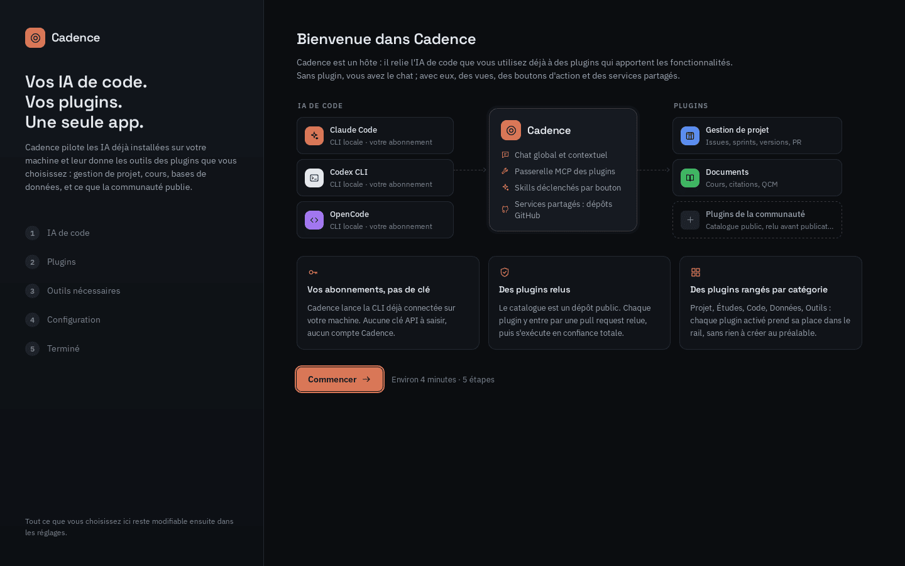
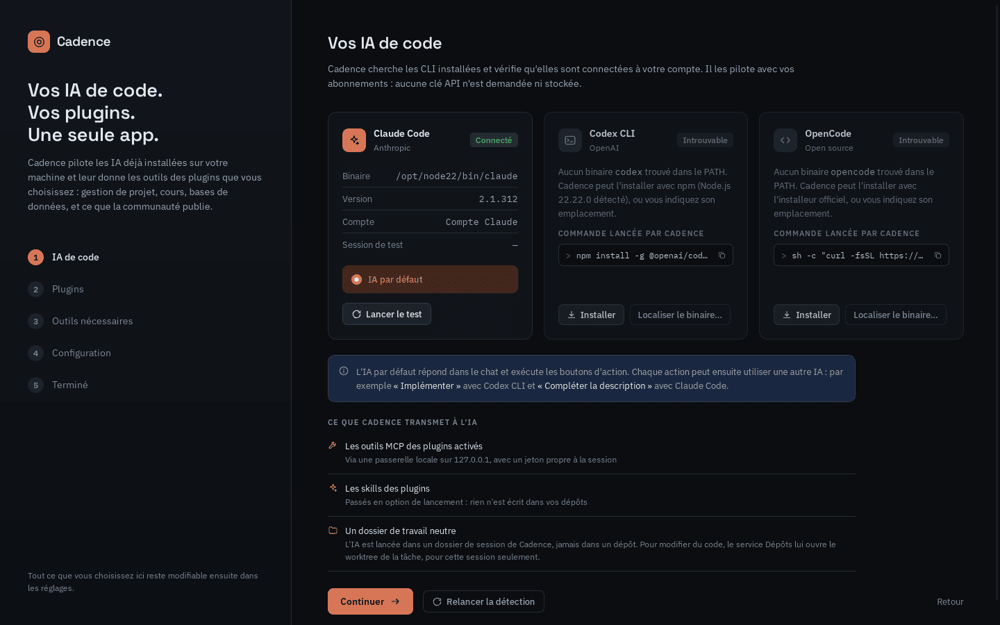
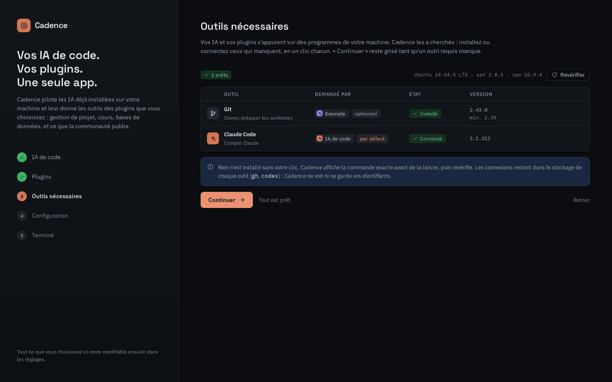
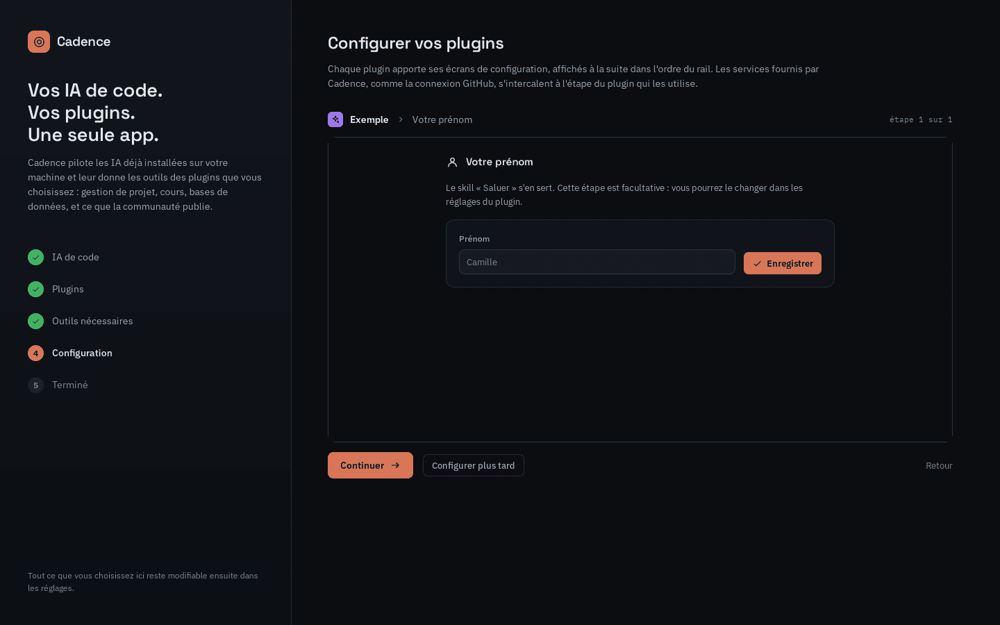
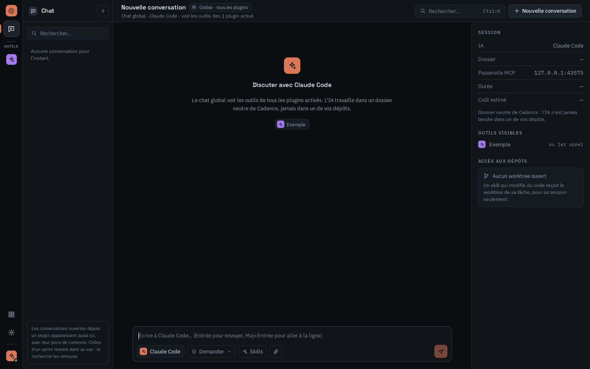
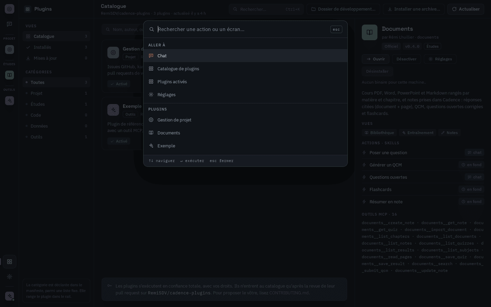
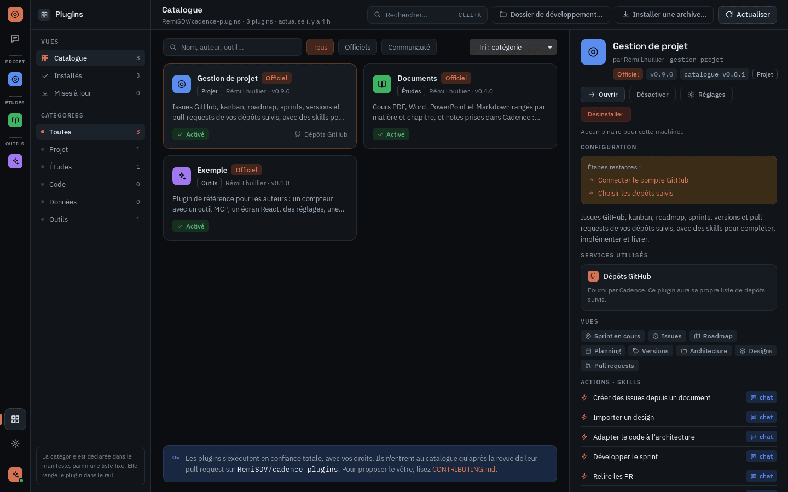
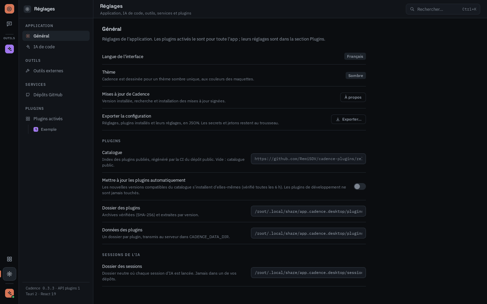

# Guide d'utilisation de Cadence

Ce guide suit un premier usage de Cadence, de l'installation aux plugins. Présentation de l'app :
[README](../README.md). Fonctionnement interne : [documentation technique](technique.md).

1. [Installer](#1-installer)
2. [Premier lancement](#2-premier-lancement)
3. [Se repérer](#3-se-repérer)
4. [Discuter avec l'IA](#4-discuter-avec-lia)
5. [Installer et gérer des plugins](#5-installer-et-gérer-des-plugins)
6. [Connecter GitHub](#6-connecter-github)
7. [Réglages](#7-réglages)

## 1. Installer

Téléchargez l'installeur de votre système sur la page des
[releases](https://github.com/RemiSDV/cadence/releases/latest) :

- **Windows** : lancez `Cadence_<version>_x64-setup.exe`. Les mises à jour suivantes s'installent
  depuis l'app (Réglages › Général › À propos).
- **Linux** : `.deb` (Debian, Ubuntu), `.rpm` (Fedora, openSUSE) ou `.AppImage` (toutes
  distributions, rendez le fichier exécutable puis lancez-le). Il faut une distribution récente
  (Ubuntu 24.04, Debian 13, Fedora 40 ou plus). Les nouvelles versions s'installent à la main.

Il vous faut aussi au moins une **IA de code** installée et connectée à votre compte :
[Claude Code](https://docs.anthropic.com/fr/docs/claude-code), Codex CLI ou OpenCode. Si elle
manque, Cadence propose de l'installer au premier lancement.

## 2. Premier lancement

Un parcours en cinq étapes (environ 4 minutes) prépare l'app. Tout reste modifiable ensuite dans
les réglages.

1. **IA de code** : Cadence cherche Claude Code, Codex CLI et OpenCode, vérifie qu'ils sont
   connectés à votre compte et propose d'installer ceux qui manquent (la commande exacte est
   affichée avant d'être lancée). Choisissez l'**IA par défaut** : elle répond dans le chat et
   exécute les boutons d'action. « Lancer le test » ouvre une courte session pour vérifier que tout
   répond.
2. **Plugins** : cochez les plugins du catalogue à installer. Aucun n'est obligatoire : le chat
   fonctionne sans.
3. **Outils nécessaires** : Cadence vérifie les programmes dont dépendent vos IA et vos plugins
   (Git, CLI GitHub…). « Continuer » reste grisé tant qu'un outil requis manque.
4. **Configuration** : chaque plugin affiche ses propres étapes (connexion GitHub et dépôts suivis
   pour Gestion de projet, par exemple). « Configurer plus tard » les reporte.
5. **Terminé** : un récapitulatif, puis « Ouvrir Cadence ».

| IA de code | Outils nécessaires | Configuration d'un plugin |
| --- | --- | --- |
|  |  |  |

## 3. Se repérer

- **Le rail** (colonne de gauche) : le chat en haut, puis un bouton par plugin activé, rangé dans
  le groupe de sa catégorie (Projet, Études, Code, Données, Outils). En bas : le catalogue, les
  réglages et l'IA par défaut (la pastille verte indique qu'elle est connectée).
- **La barre contextuelle** (deuxième colonne) : les vues et les conversations de l'écran courant.
- **Le contenu** au centre ; dans le chat, un panneau à droite résume la session (IA, outils
  visibles, accès aux dépôts).
- **`Ctrl+K`** ouvre la palette : aller à un écran, ouvrir un plugin, lancer une action.

## 4. Discuter avec l'IA

Le **chat** voit les outils de tous les plugins activés. Une conversation ouverte depuis un plugin
(le `+` de « Conversations » dans sa barre) lui est rattachée et apparaît aussi dans sa barre ;
celles d'un sprint restent dans la vue du sprint. Sous la zone de saisie :

- le choix de l'**IA** pour cette conversation ;
- le **mode** :
  - *Demander* : chaque commande, modification ou outil attend votre accord ;
  - *Édition auto* : l'IA modifie les fichiers sans demander, mais demande avant une commande ;
  - *Auto* : tout est autorisé, à réserver aux tâches sûres.

  « Autoriser pour la session » évite de redemander pour une même famille de commandes ;
- **Skills** pour déclencher un skill d'un plugin, et le trombone pour joindre un fichier.

Quand l'IA attend une réponse de votre part, la conversation l'indique (« En attente de votre
réponse »). Les conversations se retrouvent dans la barre de gauche et par la recherche.

L'IA travaille toujours dans un dossier neutre de Cadence, jamais directement dans vos dépôts :
quand une action doit toucher au code, Cadence lui ouvre une copie de travail dédiée à la tâche,
pour cette session seulement.

## 5. Installer et gérer des plugins

Le **catalogue** (icône en grille en bas du rail) liste les plugins publiés, filtrables par
catégorie. La fiche d'un plugin montre ses vues, ses actions (*chat* : ouvre une conversation ;
*en fond* : s'exécute sans vous) et ses outils. Depuis la fiche : **Installer**, **Ouvrir**,
**Désactiver**, **Réglages**, **Désinstaller** (les données du plugin sont conservées).

En haut du catalogue :

- **Installer une archive…** : un fichier `.zip` de plugin reçu ou téléchargé ;
- **Dossier de développement…** : pour les auteurs de plugins ;
- **Actualiser** : relit le catalogue. Les mises à jour peuvent aussi s'installer seules (Réglages ›
  Général › « Mettre à jour les plugins automatiquement »).

Le mode d'emploi de chaque plugin officiel (Gestion de projet, Documents, Exemple) est dans le
[guide des plugins](https://github.com/RemiSDV/cadence-plugins/blob/main/docs/utilisation.md).

> **Linux** : les plugins Gestion de projet et Documents ne sont pas encore publiés pour Linux :
> le catalogue les marque « Incompatible ». Le guide des plugins explique comment les installer en
> attendant.

## 6. Connecter GitHub

Les plugins qui travaillent sur GitHub (Gestion de projet) utilisent la connexion de Cadence :
**Réglages › Dépôts GitHub › Se connecter avec GitHub**, ou l'étape proposée à l'onboarding.
Cadence propose, selon ce qui est installé sur votre machine :

- **le compte de la CLI GitHub** : si `gh` est déjà connecté, un clic suffit ;
- **le navigateur** : GitHub s'ouvre, vous autorisez, Cadence reprend la main ;
- **un code d'appairage** à saisir sur github.com/login/device ;
- **un jeton personnel** collé dans l'app.

Le jeton est rangé dans le trousseau du système (Gestionnaire d'identifiants Windows, Secret
Service sous Linux) : il n'est jamais affiché ni écrit sur disque. Ensuite, chaque plugin a sa
liste de **dépôts suivis** (« Choisir des dépôts »).

## 7. Réglages

- **Général** : version et mises à jour de Cadence (À propos), export de la configuration (les
  secrets restent au trousseau), catalogue et mise à jour automatique des plugins, dossiers de
  l'app.
- **IA de code** : détection, IA par défaut, IA utilisée par chaque action.
- **Outils externes** : état des programmes requis, installation en un clic.
- **Dépôts GitHub** : compte connecté, emplacement des clones, dépôts suivis par plugin.
- **Plugins activés** : ordre du rail, réglages de chaque plugin.
